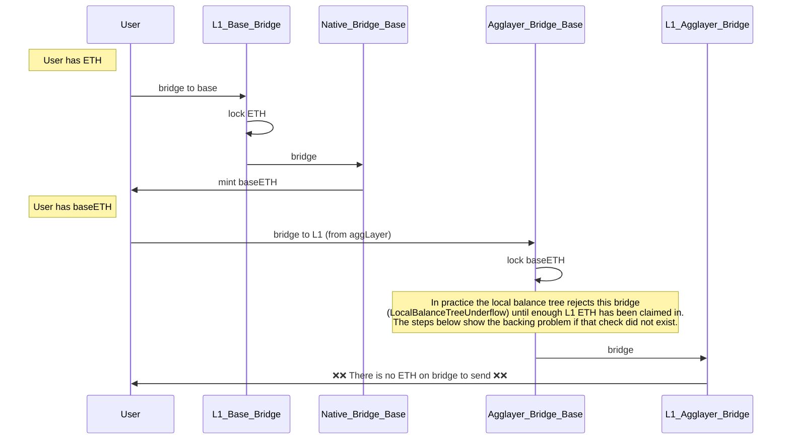
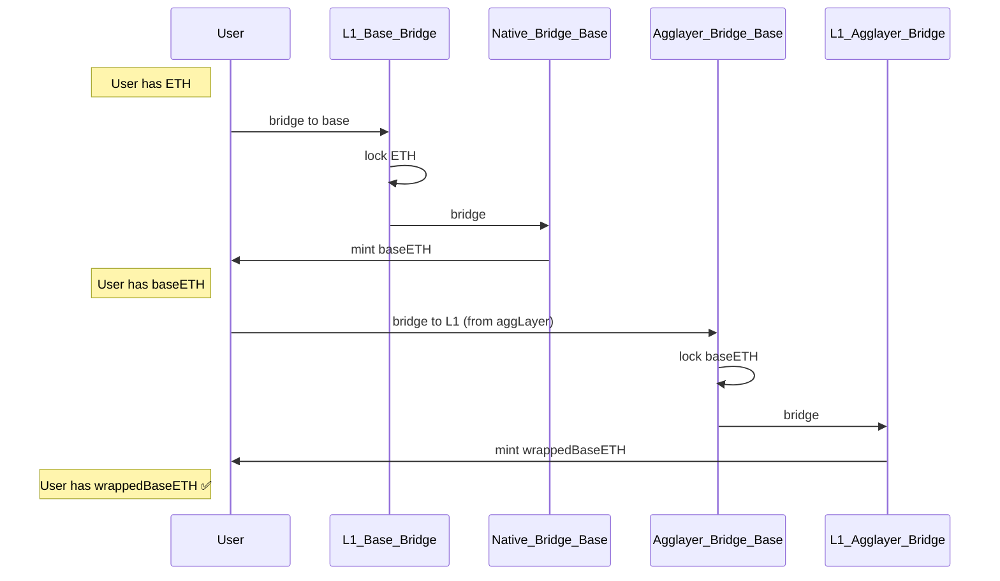

# Intro

## 1. What is an outpost chain

- Chain that **owns a different native bridge** not controlled by the **PP (Pessimistic Proof)**
- Is **EVM compatible** (in a first stage)
- The chain **already exists**, we are not involved on the genesis
- The **state transition is not controlled** by us (**not controlled sequencer**)
- Has **its own finality**
- The chain **already has its own native coin** (gas token), which must be declared on the Agglayer bridge at initialization (`gasTokenAddress`, `gasTokenNetwork`, `gasTokenMetadata`). See [5.3 Gas token configuration](Gas-token.md)
    - **Native L2 token** (recommended, used by the deployment tool): the native coin is declared as a token originating on the outpost (`gasTokenNetwork = rollupID`, `gasTokenAddress` derived from the `rollupID`). Bridging it out produces a wrapped token on the destination, and L1 ETH arrives on the outpost as a WETH ERC20
    - **External token** (e.g. declaring the native coin as L1 ETH with `gasTokenAddress = 0x0`, `gasTokenNetwork = 0`): accepted by the contract, but the outpost bridge must be pre-funded with native coin and the native coin cannot be bridged out until an equivalent amount has been claimed in. Not suitable for outposts (see [4.1](#41-outpost-declaring-its-native-coin-as-l1-eth-external-token))
- **Examples**:
    - Base
    - Optimism
    - BSC

---

## 2. Architecture

**Key points:**

- The outpost chain has its **own native bridge** and **sequencer** — neither is controlled by the Agglayer
- Agglayer L2 contracts (`AgglayerBridgeL2`, `AgglayerGERL2`) are deployed **on the outpost chain**
- The **Pessimistic Proof** verifies the bridge activity on the outpost
- The outpost needs the **Agglayer Core SC** to be deployed on the L1 chain

---

## 3. Particularities

- **Bridge, GER and wTokens** have **different addresses**
- Reorgs can happen not controlled by the agglayer
    - New functions in the bridge to manage Local Exit Tree possible mismatches

## 4. Flow examples
### 4.1 Outpost declaring its native coin as L1 ETH (external token)

Example flow of an outpost whose `gasTokenNetwork` is different from its own networkID/rollupID. Here the native coin (`baseETH`) is declared as L1 ETH:

- Initialize params:
    - `gasTokenNetwork`: `0` (Ethereum L1)
    - `gasTokenAddress`: `0x0000000000000000000000000000000000000000` (ETH)

The ETH behind `baseETH` is locked in Base's own L1 bridge, not in the Agglayer L1 bridge, so the Agglayer L1 bridge has nothing to release. In practice the flow is stopped earlier, by the **local balance tree**: bridging out `(0, 0x0)` is only possible up to the amount of L1 ETH previously claimed into the outpost. With the current `AgglayerBridgeL2`, `bridgeAsset` on the outpost reverts with `LocalBalanceTreeUnderflow`, and the pessimistic proof would reject the exit as well. In the other direction, L1 ETH claimed on the outpost is paid in native coin from the outpost bridge balance, so the bridge would have to be pre-funded. See [5.3 Gas token configuration](Gas-token.md#3-option-b-external-token).

### 4.2 Outpost with native L2 token

Example flow of an outpost whose `gasTokenNetwork` is its own networkID/rollupID. For the Base outpost on Bali (`rollupID = 63`):

- Initialize params:
    - `gasTokenNetwork`: `63` (the outpost rollupID)
    - `gasTokenAddress`: `0x0000003f0000003f0000003f0000003f0000003f` (rollupID as 32-bit hex repeated 5 times, see [5.3 Gas token configuration](Gas-token.md#21-convention))
    - `gasTokenMetadata`: `abi.encode(name, symbol, decimals)` of the native coin

The user receives `wrappedBaseETH` on L1, a wrapped ERC20 deployed with `gasTokenMetadata`, not ETH. Bridging `wrappedBaseETH` back releases native `baseETH` on the outpost from the bridge balance. L1 ETH bridged to the outpost through the Agglayer arrives as the WETH ERC20, not as gas; to get native `baseETH` for gas, users use Base's canonical bridge. See the [full flow table](Gas-token.md#22-bridging-flows).
