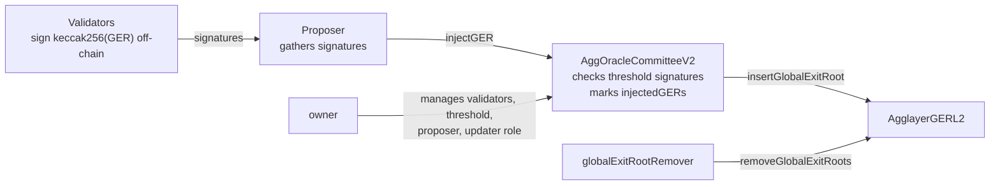

# AggOracleCommitteeV2

!!! warning "Work in progress"

    `AggOracleCommitteeV2` is under active development and not released yet. This specification may change before the contract ships.

Source: `contracts/sovereignChains/AggOracleCommitteeV2.sol` in [agglayer-contracts](https://github.com/agglayer/agglayer-contracts) (branch `feature/agg-oracle-comittee-v2`, version `v1.0.0`).

Signature-based committee contract that manages the insertion of GERs into `AgglayerGERL2`. A single proposer submits each GER together with the signatures of a threshold of validators; the contract verifies them and inserts the GER. Inherits from `Ownable2StepUpgradeable`.

Types below are language agnostic: `address` = 20 bytes, `bytes32` = 32 bytes, `uint` = unsigned 256-bit integer, `bytes` = variable-length byte string.

---

## 1. Design Choices

- **Off-chain signatures**: validators sign each GER off-chain and never send transactions. Only the proposer sends one transaction per GER, carrying exactly `threshold` signatures.
- **No domain in the signed message**: validators sign the raw digest `keccak256(ger)`, with no chain id, no contract address, no prefix, no nonce and no expiry. The same signatures are valid on any committee that shares the validator keys, and stay valid while their signers remain validators.
- **A GER is processed only once**: once this contract has processed a GER (inserted it, or found it already set in `AgglayerGERL2`), it can never inject it again, even if `AgglayerGERL2` later removes it. Later GERs carry the same exits.
- **Signatures are checked at injection time**: against the validator set and threshold current when `injectGER` runs, not when the validators signed.
- **Threshold rules**: `1 ≤ threshold ≤ number of validators ≤ 255`. A committee with no validators cannot exist.
- **Ownership cannot be lost**: ownership is transferred in two steps and `renounceOwnership` is disabled, so validators and proposer can always be updated.
- **Validator URL (optional)**: each validator is registered with an optional `url` in `ValidatorInfo = (addr, url)` (e.g. the endpoint where it serves signature requests). It is stored on-chain in `validatorInfo` and returned by `getValidatorsInfo()`, so the proposer can discover where to request signatures. The contract never reads it. It is set when the validator is added; to change it, remove and re-add the validator in one `updateValidatorsAndThreshold` call.

---

## 2. Invariants and Operational Rules

**Invariants**:

- `1 ≤ threshold ≤ len(validators) ≤ 255` after every successful call
- `validators` and `validatorInfo` always describe the same set: no duplicates, no zero address, never the contract itself
- After `injectedGERs[ger]` is set, `injectGER` and `verifyGER` reject `ger` forever
- Only the proposer can cause an insertion, and only with exactly `threshold` valid, ordered signatures from current validators
- The contract always has an owner

**Operational rules**:

- Validators must not sign a GER that has been removed from `AgglayerGERL2`. A GER inserted by another updater and removed before this committee processed it is not tracked by `injectedGERs`
- Recommended: do not reuse validator keys across environments (e.g. two testnets on different L1s), since signatures carry no domain
- Off-chain clients deciding whether to inject must check `injectedGERs` as well as `AgglayerGERL2`: a removed GER looks absent in `AgglayerGERL2` but is rejected here
- Ownership handover takes two transactions; when the new owner is a multisig or timelock, `acceptOwnership` must be executed through it
- Hand the `globalExitRootUpdater` role to the committee before the proposer starts injecting; until then injections fail

---

## 3. Architecture

`AggOracleCommitteeV2` must hold the `globalExitRootUpdater` role of `AgglayerGERL2` to insert GERs. The `globalExitRootRemover` is a role of `AgglayerGERL2`, outside this contract.

---

## 4. Roles

| Role | Description |
|------|-------------|
| `owner` | Manages validators, threshold, proposer and the GER updater role transfer |
| `proposer` | Submits GERs with the validators' signatures |
| Validator | Signs GERs off-chain; a threshold of signatures is required per GER |

### 4.1 owner

- **Functionality**:
    - Add and remove validators and set the threshold (`updateValidatorsAndThreshold`)
    - Set the proposer (`updateAggOracleProposer`)
    - Transfer the `globalExitRootUpdater` role on `AgglayerGERL2` (`transferGlobalExitRootUpdater`)
    - Accept the `globalExitRootUpdater` role on `AgglayerGERL2` (`acceptGlobalExitRootUpdater`)
    - Start an ownership transfer (`transferOwnership`); the new owner must call `acceptOwnership`
- **Security Assumptions**: Very high. Controls who signs GERs, how many signatures are needed and who submits them. A compromised owner could add malicious validators, lower the threshold to 1 and set its own proposer, enabling insertion of invalid GERs — which could lead to theft of third-party bridge funds.
- **Recommended Account Type**: Timelock (specified by the chain itself after bootstrapping phase)

### 4.2 proposer

Single address set by the `owner`. Cannot insert a GER without `threshold` valid validator signatures.

- **Functionality**:
    - Inject a global exit root with the validators' signatures (`injectGER`)
- **Security Assumptions**: Medium. Cannot forge GERs, but can delay or withhold valid GERs (liveness), choose the order in which signed GERs are injected, and inject any signed GER that this contract has not processed yet (signatures never expire).
- **Recommended Account Type**: EOA carefully managed, since it must send frequent transactions to inject GERs

### 4.3 Validator

Membership-based role, tracked in `validators` and `validatorInfo`. Not a named Solidity role — managed by the `owner` through `updateValidatorsAndThreshold`. Validators never send transactions; each validator may publish an optional URL (see Design Choices).

- **Functionality**:
    - Sign `keccak256(ger)` for valid GERs off-chain
- **Security Assumptions**: Medium-High. A threshold of compromised validators, together with the proposer, could insert invalid GERs — unable to steal agglayer funds directly but might be able to steal third-party bridge funds. Individual validators cannot insert alone (threshold required).
- **Recommended Account Type**: Carefully managed signing keys (e.g. KMS), not shared across environments, since signatures carry no chain or contract domain

---

## 5. State and Constants

| Name | Type | Set by | Meaning |
|------|------|--------|---------|
| `VERSION` | string | constant | `"v1.0.0"` |
| `MAX_VALIDATORS` | uint | constant | 255 |
| `agglayerGERL2` | address | constructor (immutable) | The GER manager this committee inserts into. Never zero |
| `owner` / `pendingOwner` | address | ownership functions | Current owner; owner proposed but not yet accepted (zero when none) |
| `proposer` | address | `initialize`, `updateAggOracleProposer` | The only caller of `injectGER`. Never zero |
| `validators` | address[] | `updateValidatorsAndThreshold` | Current validator set; order changes on removal |
| `validatorInfo` | address → (exists: bool, url: string) | `updateValidatorsAndThreshold` | Membership flag and URL per validator |
| `threshold` | uint | `updateValidatorsAndThreshold` | Exact number of signatures required. Always `1 ≤ threshold ≤ len(validators)` |
| `injectedGERs` | bytes32 → bool | `injectGER` | GERs this committee has processed. Never cleared |

---

## 6. Signature Scheme

- **Message**: `m = keccak256(ger)`, where `ger` is the 32-byte GER
- **Signature**: secp256k1 ECDSA over `m` as a raw 32-byte digest, encoded as 65 bytes: `r` (32) ‖ `s` (32) ‖ `v` (1)
- **Bundle**: exactly `threshold` signatures concatenated, so its length is exactly `threshold × 65` bytes

Verification of `(ger, bundle)` succeeds only if:

1. `len(bundle) == threshold × 65`
2. Each signature is well formed: `v` is 27 or 28, `s` is in the lower half of the curve order, and recovery yields a non-zero address
3. Each recovered signer is a current validator
4. Recovered signers are in strictly ascending address order (this also rejects duplicate signers)

Any failed check aborts the whole call.

---

## 7. Functions

Notation: `name(param: type, …) → result`. `ValidatorInfo = (addr: address, url: string)`, `RemoveValidatorInfo = (addr: address, index: uint)`. Every failure aborts the whole call with no state change.

??? note "Functions (click to expand)"

    **`constructor(agglayerGERL2: address)`**

    - Sets the immutable `agglayerGERL2` and disables initialization of the implementation itself
    - Fails if `agglayerGERL2` is zero (`AgglayerGERL2CannotBeZero`)

    **`initialize(owner: address, proposer: address, validators: ValidatorInfo[], threshold: uint)`**

    - **Access**: anyone, once per proxy. Deploy and initialize the proxy in the same transaction
    - Sets the owner, then the proposer (emits `UpdateAggOracleProposer`), then adds the validators and sets the threshold with the rules of `updateValidatorsAndThreshold` (emits `ValidatorsAndThresholdUpdated`)
    - Fails if already initialized, `owner` is zero (`OwnerCannotBeZero`), `proposer` is zero (`ProposerCannotBeZero`), or any validator or threshold rule fails

    **`injectGER(ger: bytes32, signatures: bytes)`**

    - **Access**: `proposer` only (`OnlyAggOracleProposerCanCall`)
    - Steps:
        1. Fail if `ger` is zero (`GERCannotBeZero`) or `injectedGERs[ger]` is true (`GERAlreadyInjected`)
        2. Verify `signatures` over `ger` (see Signature Scheme)
        3. Set `injectedGERs[ger] = true`
        4. If `agglayerGERL2` already holds `ger` (inserted by another updater): emit `GERMarkedAsInjected(ger)` and stop
        5. Otherwise emit `GERInjected(ger)` and call `agglayerGERL2.insertGlobalExitRoot(ger)`. If this contract is not the updater of `agglayerGERL2`, that call fails and so does the whole injection

    **`updateValidatorsAndThreshold(toRemove: RemoveValidatorInfo[], toAdd: ValidatorInfo[], threshold: uint)`**

    - **Access**: `owner` only
    - Steps, in order:
        1. `toRemove` indices must be strictly descending (`IndicesNotInDescendingOrder`)
        2. For each entry: `index < len(validators)` (`ValidatorIndexOutOfBounds`) and `validators[index] == addr` (`ValidatorIndexMismatch`). Remove it by moving the last element into `index` and shortening the list; clear its `validatorInfo`
        3. For each entry of `toAdd`: append it. The address must not be zero (`ValidatorCannotBeZero`), the contract itself (`ValidatorCannotBeThisContract`) or already a validator (`ValidatorAlreadyExists`). The URL may be empty
        4. `len(validators) ≤ 255` (`TooManyValidators`)
        5. `threshold ≥ 1` (`ThresholdCannotBeZero`) and `threshold ≤ len(validators)` (`ThresholdCannotBeGreaterThanValidators`)
        6. Emit `ValidatorsAndThresholdUpdated(validators, threshold)`

    **`updateAggOracleProposer(proposer: address)`**

    - **Access**: `owner` only
    - Sets the proposer and emits `UpdateAggOracleProposer`. Fails if zero (`ProposerCannotBeZero`)

    **`transferGlobalExitRootUpdater(newUpdater: address)`** · **`acceptGlobalExitRootUpdater()`**

    - **Access**: `owner` only
    - Forward to the same-named functions of `agglayerGERL2`, with this contract as the caller. Used to hand the updater role to, or take it from, this committee

    **`transferOwnership(newOwner: address)`** · **`acceptOwnership()`**

    - `transferOwnership` (`owner` only) sets `pendingOwner` and emits `OwnershipTransferStarted`; passing zero cancels a pending transfer
    - `acceptOwnership` (`pendingOwner` only) makes it the owner, clears `pendingOwner` and emits `OwnershipTransferred`

    **`renounceOwnership()`**

    - Always fails (`RenounceOwnershipDisabled`)

    **Read-only**

    | Function | Returns |
    |----------|---------|
    | `verifyGER(ger: bytes32, signatures: bytes) → bool` | `true` if steps 1–2 of `injectGER` pass, otherwise fails with the same error. Does not check the caller or `agglayerGERL2` |
    | `injectedGERs(ger: bytes32) → bool` | Whether this committee has processed `ger` |
    | `getValidatorsInfo() → ValidatorInfo[]` | All validators with their URLs, in list order |
    | `getValidatorsCount() → uint` | `len(validators)` |
    | `getValidatorIndex(addr: address) → uint` | Position in `validators`; fails if absent (`ValidatorNotFound`) |
    | `validators(index: uint) → address` | Validator at `index` |
    | `validatorInfo(addr: address) → (exists: bool, url: string)` | Membership and URL |
    | `isValidator(addr: address) → bool` | Membership |
    | `threshold()`, `proposer()`, `owner()`, `pendingOwner()`, `agglayerGERL2()` | The stored value |
    | `version() → string`, `MAX_VALIDATORS() → uint` | `"v1.0.0"`, 255 |

---

## 8. Events

??? note "Events (click to expand)"

    | Event | Emitted when |
    |-------|--------------|
    | `GERInjected(ger: bytes32)` | The committee inserts `ger` into `AgglayerGERL2` |
    | `GERMarkedAsInjected(ger: bytes32)` | `ger` was already in `AgglayerGERL2`; it is only recorded as processed |
    | `UpdateAggOracleProposer(proposer: address)` | The proposer is set |
    | `ValidatorsAndThresholdUpdated(validators: address[], threshold: uint)` | The validator set or threshold changes, including at initialization |
    | `OwnershipTransferStarted(previous: address, next: address)` | An ownership transfer starts |
    | `OwnershipTransferred(previous: address, next: address)` | Ownership changes |

---

## 9. Errors

??? note "Errors (click to expand)"

    | Error | Raised by |
    |-------|-----------|
    | `AgglayerGERL2CannotBeZero` | constructor |
    | `OwnerCannotBeZero`, `ProposerCannotBeZero` | `initialize`, `updateAggOracleProposer` |
    | `OnlyAggOracleProposerCanCall` | `injectGER` from any other caller |
    | `GERCannotBeZero`, `GERAlreadyInjected` | `injectGER`, `verifyGER` |
    | `InvalidSignaturesLength`, `ValidatorDoesNotExist`, `ValidatorsNotOrdered` | signature checks |
    | Malformed signature (bad `v`, high `s`, zero signer) | signature checks |
    | `ValidatorCannotBeZero`, `ValidatorCannotBeThisContract`, `ValidatorAlreadyExists` | adding a validator |
    | `ValidatorIndexOutOfBounds`, `ValidatorIndexMismatch`, `IndicesNotInDescendingOrder` | removing validators |
    | `TooManyValidators`, `ThresholdCannotBeZero`, `ThresholdCannotBeGreaterThanValidators` | validator and threshold updates |
    | `ValidatorNotFound` | `getValidatorIndex` |
    | `RenounceOwnershipDisabled` | `renounceOwnership` |
    | Unauthorized caller | `owner`-only functions, `acceptOwnership` |
